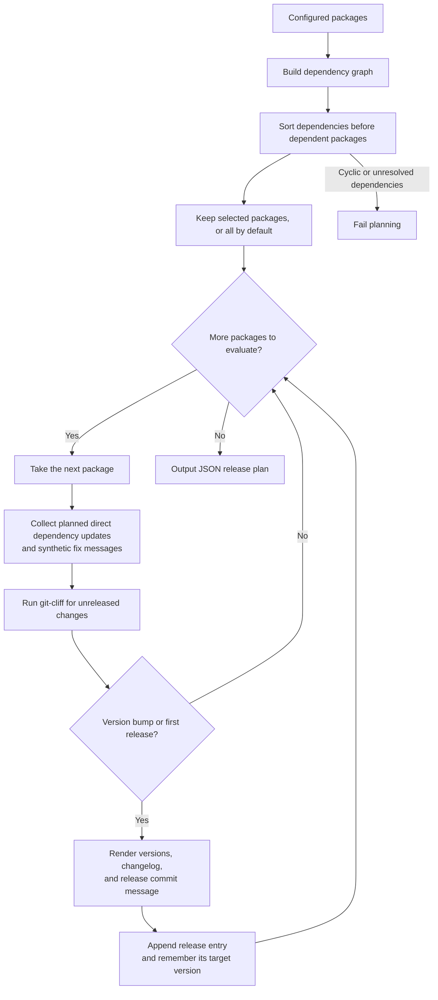

# `plan`

The `git reflow plan` command previews which packages need a release and the changes to include in their release pull requests. It produces a JSON plan containing each package's target version, release commit message, changelog, and dependency updates.

Planning **does not** modify package files, create commits or tags, or open pull requests.

> [!NOTE]
> You can save and edit the plan before passing it to `git reflow pr` with the `--plan` argument.

## Usage

Plan releases for all configured packages:

```shell
git reflow plan
```

To limit the plan to specific packages, supply their configured names:

```shell
git reflow plan example-api example-cli
```

| Option | Description |
| --- | --- |
| `-t, --target-branch <BRANCH>` | Sets the branch name available to the release commit message template. Defaults to the current branch; it does not switch branches. |
| `-c, --show-context` | Includes the full [git-cliff] context for each planned release. Omitted by default to keep the output concise. |

Package selection does not automatically include dependencies or dependent packages. To plan all affected releases, omit the package names.

## How it works

1. **Discover dependencies and determine release order.** Build a dependency graph from the configured packages and sort it so that dependencies are evaluated before the packages that depend on them. Cyclic or unresolved dependencies cause planning to fail, even when only a subset of packages is selected.
2. **Evaluate the selected packages.** Process all packages by default, or only those named in the command. For each package, collect any direct dependencies already planned for release and record their target versions.
3. **Account for dependency updates.** Add a synthetic commit message for each changing dependency, using the format `fix(deps): update dependency <package> to v<version>`, with the package name enclosed in backticks. These messages are passed to git-cliff as planning input; they are not committed to the repository.
4. **Determine whether a release is needed.** Run git-cliff using the package's directory, any additional configured change paths, and its release tag prefix. A package is included when the resulting context indicates a version bump or a first release. Otherwise, it is omitted from the plan.
5. **Build the release entry.** Read the current and target versions, render the changelog, and render the release commit message from the configured template. The template receives the package name, scope, target version, and target branch. Record the target version so that subsequent dependent packages can account for it.



### Dependency-driven releases

A package can need a release even when it has no source changes of its own. If one of its direct dependencies is planned for release, the synthetic `fix(deps)` message lets git-cliff account for that update in its version calculation and changelog. Under conventional commit rules, this typically results in a patch release; the exact behavior depends on the git-cliff configuration.

Because dependencies are evaluated first, updates can propagate through a chain of selected packages. For example, releasing a library can trigger a release of a CLI that depends on it, which can in turn trigger releases of packages that depend on that CLI.

## Plan format

The output is a JSON array in dependency order. Only packages that need a release appear in the array; when none do, the output is `[]`.

| Field | Description |
| --- | --- |
| `package-name` | The configured package name. |
| `current-version` | The previous release version, or `null` for a first release. |
| `next-version` | The target version for this release. |
| `commit-message` | The rendered release commit message. |
| `changelog-md` | The rendered Markdown changelog for this release. |
| `dependencies` | A map of direct dependencies planned for release to their target versions. Empty when no direct dependencies are changing. |
| `context` | The git-cliff context used to generate the release entry. Included only with `--show-context`. |

## Example

Suppose `example-api` gains a new feature and `example-cli` depends on it. The root package also includes the API changes in its changelog. With conventional commit rules, the root package and API receive minor releases, while the CLI receives a patch release for its dependency update:

```shell
git reflow plan
```

```json
[
  {
    "package-name": "example-python-workspace",
    "current-version": "1.0.0",
    "next-version": "1.1.0",
    "commit-message": "chore: release v1.1.0",
    "changelog-md": "## [1.1.0] - 2026-11-14\n\n### 🚀 Features\n\n- *(api)* Add a `subtract` function",
    "dependencies": {}
  },
  {
    "package-name": "example-api",
    "current-version": "1.0.0",
    "next-version": "1.1.0",
    "commit-message": "chore(api): release v1.1.0",
    "changelog-md": "## [1.1.0] - 2026-11-14\n\n### 🚀 Features\n\n- *(api)* Add a `subtract` function",
    "dependencies": {}
  },
  {
    "package-name": "example-cli",
    "current-version": "1.0.0",
    "next-version": "1.0.1",
    "commit-message": "chore(cli): release v1.0.1",
    "changelog-md": "## [1.0.1] - 2026-11-14\n\n### 🐛 Bug Fixes\n\n- *(deps)* Update dependency `example-api` to v1.1.0",
    "dependencies": {
      "example-api": "1.1.0"
    }
  }
]
```

## Review and apply a plan

Save the output to a file:

```shell
git reflow plan > plan.json
```

Review the JSON and make any necessary adjustments. Keep the entries in dependency order and ensure that target versions, dependency versions, commit messages, and changelogs remain consistent.

Then create or update the release pull requests using that file:

```shell
git reflow pr --plan plan.json
```

When `--plan` is supplied, `git reflow pr` reads the saved plan instead of generating a new one. Without it, the command generates a plan automatically.

[git-cliff]: https://github.com/orhun/git-cliff
