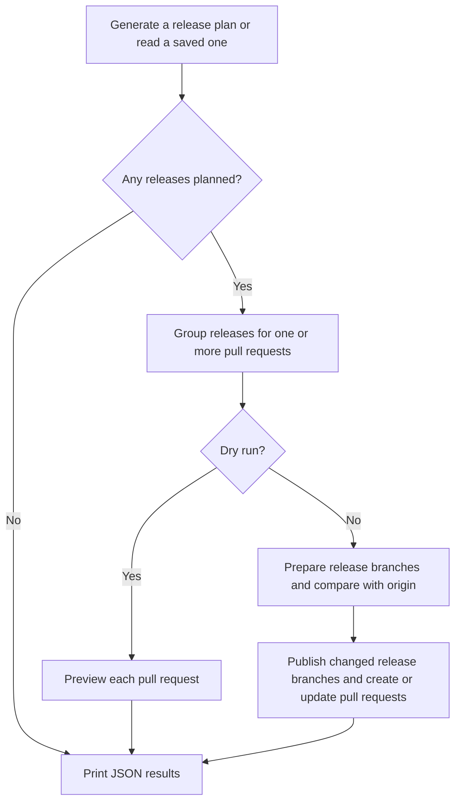

# `pr`

The `git reflow pr` command takes a [release plan](./04-plan.md), commits the version and changelog updates to a
release branch, and creates or updates a pull request on the configured Git provider. By default, it combines all
planned releases into one pull request.

> [!NOTE]
> This command does not tag or publish releases. After merging the release pull request, use
> [`git reflow release`](./06-release.md).

## Usage

Run the command from the branch you want the release pull request to merge into. Applying a non-empty plan requires an
`origin` remote and no uncommitted changes to tracked files, even for a dry run. For a live run, make sure Git can push
to `origin` and the [configured Git provider](./02-configuration.md) can create and update pull requests.

Generate a plan for all configured packages and create or update the release pull request:

```shell
git reflow pr
```

To limit automatic planning to specific packages, supply their configured names:

```shell
git reflow pr example-api example-cli
```

To preview the pull request without writing release files, creating release branches or commits, pushing, or opening or
updating a pull request, use `--dry-run`:

```shell
git reflow pr --dry-run
```

To preview and then apply a saved plan, run:

```shell
git reflow plan > plan.json
# Review and edit plan.json if needed.
git reflow pr --plan plan.json --dry-run
git reflow pr --plan plan.json
```

`-p, --plan <PLAN>` uses the entries in the JSON file as-is instead of generating a new plan. Positional package
names do not filter a saved plan.

> [!IMPORTANT]
> `-t, --target-branch <BRANCH>` defaults to the checked-out branch. Currently, it only sets the
> `branch` value in commit message templates when generating a plan. It does not switch branches or change the pull
> request's base. Check out the intended base branch before running `pr`, including when using a saved plan.

## How it works



1. **Group the planned releases.** By default, all releases share one branch and pull request. Set
   `git.separate-pull-requests` to `true` in the [configuration](./02-configuration.md) to create one per package.
   With the default branch prefix, a combined release for `main` uses `reflow--branches--main`, while a separate
   release for `example-api` uses `reflow--branches--main--example-api`.
2. **Prepare the release changes.** For each group, start from the checked-out branch's commit. Apply package version
   and dependency updates, write any configured changelogs, and update any additional files configured for the package.
3. **Update the release branch and pull request.** If the remote release branch already has the same file contents
   and commit message, skip it. Otherwise, publish the release commit to `origin` and create or update the pull request.
   The command will force-push the generated branch.

## Output

The output is a JSON array of the pull requests the command created or updated. An empty plan returns `[]`, as does
a live run that skips every release branch because it already matches `origin`.

| Field      | Description                                                                                     |
|------------|-------------------------------------------------------------------------------------------------|
| `number`   | The pull request number.                                                                        |
| `url`      | The pull request URL.                                                                           |
| `title`    | The pull request title.                                                                         |
| `body`     | The pull request body, or `null` if absent.                                                     |
| `head`     | The release branch containing the changes.                                                      |
| `base`     | The branch the pull request merges into.                                                        |
| `existing` | `true` if the pull request was updated, or `false` if it was created.                            |
| `packages` | The included packages, each with a `name`, target `version`, and `changelog_md`.                  |

A dry run previews each planned pull request with `number: 0`, an empty `url`, and `existing: false`. It does not
compare the proposed changes with the remote branch, so it may preview a pull request that a live run would skip.
